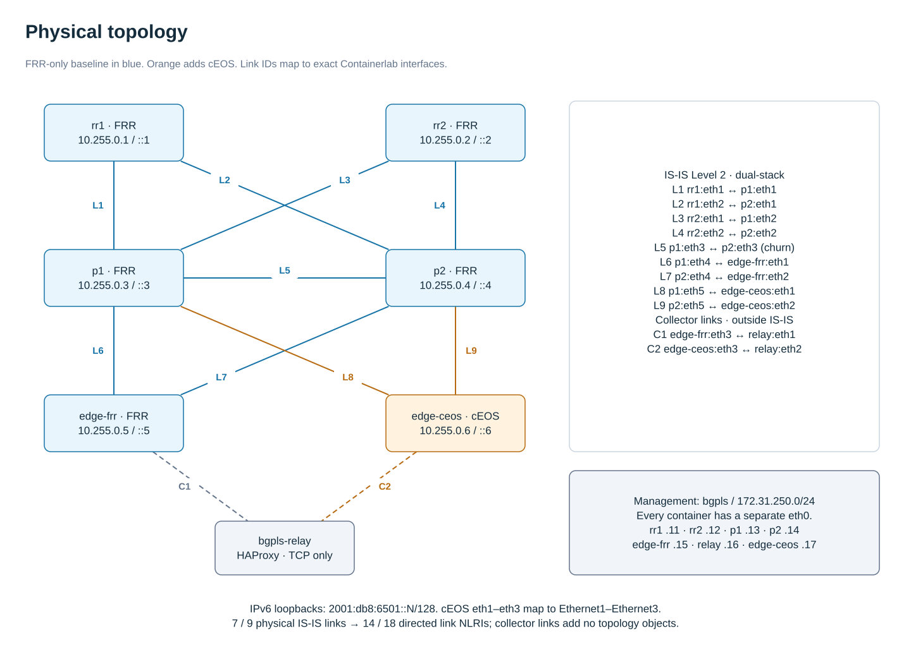

# Run your first bgpls lab on a Mac

This walkthrough uses an ARM64 environment on an Apple Silicon Mac. bgpls is
multiplatform and supports both ARM and x86-64.



The blue FRRouting topology includes the **p1–p2** link used in this exercise.
Orange marks the optional cEOS extension.

Bring up five virtual FRRouting routers, connect a Swift collector, then take
one link down and watch the routers report the change. Use two macOS Terminal
tabs: **Collector** for the live output and **Control** for the link between routers that you will take down and restore. VS Code
shows how those routers are wired. You can complete the exercise with Terminal alone.


Follow the arrows from **Control** to the p1–p2 link, then back from
**edge-frr** to **Collector** to see how a link change reaches your screen.
[Editable terminal diagram](Lab%20Topology.drawio)

## 1. Gather the software

| Software | Where you use it | What you need |
| --- | --- | --- |
| [Terminal](https://support.apple.com/guide/terminal/welcome/mac) | Mac | Built in. Press ⌘Space, type **Terminal**, then press Return. Use an Apple Silicon Mac with macOS 15 or newer for this walkthrough. |
| [bgpls](https://github.com/RouteObjects/bgpls) | Mac | The source includes the CLI, router configurations, and lab scripts. |
| [Swift](https://www.swift.org/install/macos/), Git, Bash, and [Python](https://www.python.org/downloads/macos/) | Mac | Swift 6.3 or newer, Git to clone, the built-in Bash, and `python3` 3.9 or newer. If Git is missing, run `xcode-select --install` for Apple’s command-line tools. |
| [OrbStack](https://docs.orbstack.dev/install) | Mac | [Download](https://orbstack.dev/download), install and open the app. Its `orb` command selects the Linux machine for the scripts. |
| [Docker Engine](https://docs.docker.com/engine/install/ubuntu/) and [Containerlab](https://containerlab.dev/install/) | Inside the OrbStack machine named `clab` | The setup in step 3 installs both in Ubuntu 24.04 ARM64. It pins Containerlab 0.83.0, the minimum stable release for a fresh deployment. |
| Optional software for visualization | | |
| [Visual Studio Code](https://code.visualstudio.com/download) and [Remote - SSH](https://marketplace.visualstudio.com/items?itemName=ms-vscode-remote.remote-ssh) | Mac | For the topology view, install VS Code and install Microsoft’s **Remote - SSH** extension locally. |
| [Containerlab extension](https://marketplace.visualstudio.com/items?itemName=srl-labs.vscode-containerlab) | VS Code on the SSH host | Install this extension after connecting to `clab` in step 4. These two extensions are sufficient. |

Allow internet access for the first build and the container image downloads.
The FRR-only lab uses publicly available router images.

## 2. Get the source and build the collector

In the **Collector** tab on the Mac, clone the public repository into
`$HOME/Developer/bgpls`.

```sh
mkdir -p "$HOME/Developer"
cd "$HOME/Developer"
git clone https://github.com/RouteObjects/bgpls.git
cd bgpls
```

If you downloaded a source ZIP from GitHub, extract it and open the directory
containing `Package.swift`. From the project root, check the tools and build
the release executable.

```sh
swift --version
python3 --version
swift build -c release --product bgpls
.build/release/bgpls run --help
```

You should see the collector’s options, including `--peer` and `--watch`.

## 3. Prepare the Linux host and deploy the routers

For a first installation, follow the [one-time OrbStack setup](OrbStackSetup.md)
from the repository root. It creates `clab`, installs Docker Engine and
Containerlab inside it, and verifies the Docker socket and shared Mac paths.
If `clab` is already prepared, skip machine creation. In **macOS Terminal**,
confirm the guest tools work before deploying:

```sh
orb -m clab -u root docker info --format '{{.OSType}}/{{.Architecture}}'
orb -m clab -u root containerlab version --short
```

Expect `linux/aarch64` or `linux/arm64`, and stable Containerlab 0.83.0 or
newer. The guest needs the lab name `bgpls` and management subnet
`172.31.250.0/24` available. Reserve Mac localhost port `11790` for the
collector. If you run other labs or a VPN, check the
[lab address ranges](../../lab-examples/bgpls/README.md#topology-and-configuration).

From the bgpls repository root, choose a fresh deployment directory **outside** the
repository. Keep its printed absolute path for VS Code and for cleanup:

```sh
export CLAB_MACHINE=clab
LAB_DIR="$HOME/clabs/bgpls-demo"
mkdir -p "$HOME/clabs"
./lab-examples/bgpls/deploy.sh "$LAB_DIR"
printf '%s\n' "$LAB_DIR"
```

A successful deploy prints `FRR relay: 127.0.0.1:11790`. The relay forwards
the Mac collector’s TCP connection to `edge-frr`, the router that advertises
the topology. There is room for one collector on this producer.

## 4. (Optional) Open the topology in VS Code

This step is optional. Leave the **Collector** tab available for step 5.

1. In the second Mac Terminal tab (**Control**), run
   `ssh clab@orb 'id -nG && docker ps && containerlab inspect --all'`. You should
   see the running lab. The extension expects the guest user to have Docker
   access and belong to both `docker` and `clab_admins`. On your own dedicated
   lab guest, if the groups are missing, run the block below. These groups grant
   administrative access inside that guest. Reconnect to SSH after changing them.

   ```sh
   GUEST_USER=$(orb -m clab id -un)
   orb -m clab -u root usermod -aG docker,clab_admins "$GUEST_USER"
   ssh clab@orb 'id -nG && docker ps && containerlab inspect --all'
   ```

2. On the Mac, open VS Code. Press **⇧⌘P**, select **Remote-SSH: Connect to
   Host…**, and enter `clab@orb`. In the new SSH window, open **Extensions**
   (⇧⌘X), search for `srl-labs.vscode-containerlab`, and install **Containerlab**
   on the SSH host.
3. Choose **File → Open Folder…** and paste the **absolute path printed in
   step 3**. The remote window has a Linux home directory, so typing
   `~/clabs/bgpls-demo` there can open the wrong folder. Open the deployed
   `bgpls.clab.yml` and press **⌘⌥G** for **Graph with TopoViewer**.
4. Find `p1`, `p2`, and the link between their `eth3` interfaces. The diagram
   also contains `rr1`, `rr2`, `edge-frr`, and `bgpls-relay`. The relay is
   the sixth container. The collector will report five routers.

Use VS Code to view the graph, node terminals, and logs. Use the supplied
scripts for deployment, link changes, and teardown so they operate on the
recorded lab. [OrbStack SSH](https://docs.orbstack.dev/machines/ssh) ·
[Containerlab extension guide](https://containerlab.dev/manual/gui/vsc-extension/)

## 5. Connect and read what the network advertises

Back in the **Collector** tab, run this from the repository root and leave it
running. To put the collector beside the graph in the same VS Code window,
choose **Terminal: Create New Integrated Terminal (Local)** from the Command
Palette, then `cd` to the Mac repository. In either case, `uname -s` should
print `Darwin`.

```sh
.build/release/bgpls run \
  --peer 127.0.0.1 --port 11790 \
  --local-as 65001 --peer-as 65001 \
  --bgp-identifier 192.0.2.101 --local-address 127.0.0.1 \
  --hold-time 9 --watch --show-attributes --dump-rib
```

An empty initial snapshot is normal. After `state Established`, look for these
parts of the five-router topology. The order of the updates can vary.

| In the collector | What to look for |
| --- | --- |
| `WATCH upsert node` | Find `name="p2"`. Match it to the router in VS Code. |
| `WATCH upsert link` | Find the entries with `10.254.0.8` (p1) and `10.254.0.9` (p2). Each router advertises its direction of the physical link. The `igp-metric` field shows its routing cost. |
| `WATCH upsert prefix` | Find p2’s IPv4 loopback `10.255.0.4/32` and IPv6 loopback `2001:db8:6501::4/128`. Both arrive on the same IPv4 BGP session. |

## 6. Watch one link disappear and return

Wait until you have seen **both directions** of the p1–p2 link. In the **Control**
tab on the Mac, select the same repository, guest, and deployment directory
you used in step 3. Substitute your paths below if you used a source ZIP or
chose another directory.

```sh
cd "$HOME/Developer/bgpls"
export CLAB_MACHINE=clab
LAB_DIR="$HOME/clabs/bgpls-demo"
./lab-examples/bgpls/churn-link.sh "$LAB_DIR" down
```

In **Collector**, look for **two** `WATCH withdraw link` events, one from
`10.254.0.8` to `10.254.0.9` and one in reverse. The collector stays
connected. As soon as you see both, run the following in **Control**. **Restore
the link even if you miss the events**: allow up to 90 seconds, then run `up`
anyway. An explicit `down` remains in effect until restored.

```sh
./lab-examples/bgpls/churn-link.sh "$LAB_DIR" up
```

Watch for two new `WATCH upsert link` events on the same session. Compare each
direction's IPv4 and IPv6 endpoints with its original advertisement. A matching
count alone could hide a different link identity. Give the routers time to
converge before stopping the collector. The graph shows the
lab wiring; the collector output tells you what FRR withdrew and re-advertised.
A short timed flap can finish before both withdrawals reach the collector.

## 7. Stop and clean up

Press **Ctrl-C** in **Collector**. Look for `SIGINT — session stopped`, then
`RIB final` and **`nodes=5 links=14 prefixes=10`**. Seven physical IS-IS links
account for the fourteen directed link records. If extra links persist after
restoration, see the [known FRR limitation](../../lab-examples/bgpls/README.md#known-frr-limitation).

If you used the default relay port and want an automated check of the withdrawals and exact restoration, run
[automated verification](ScriptExamples.md#automated-verification) now. It
starts its own collector after you stop yours.

In **Control**, remove just this deployment:

```sh
./lab-examples/bgpls/destroy.sh "$LAB_DIR"
```

The `clab` machine and the state directory remain. Choose a fresh `LAB_DIR`
for the next run.

### If the Mac cannot reach the relay

If deployment printed the relay address but the connection in step 5 was
refused, or another guest also exposes a bgpls relay, select the intended guest
explicitly through SSH. In an extra **Mac Terminal** tab, forward a free Mac port
to that guest's listener. Replace `clab` with the name used during deployment:

```sh
ssh -N -o ExitOnForwardFailure=yes -L 127.0.0.1:21790:127.0.0.1:11790 clab@orb
```

Leave that tab open. Repeat the collector command with `--port 21790`. After
stopping the collector, press Ctrl-C in the SSH tab to close the forward.
