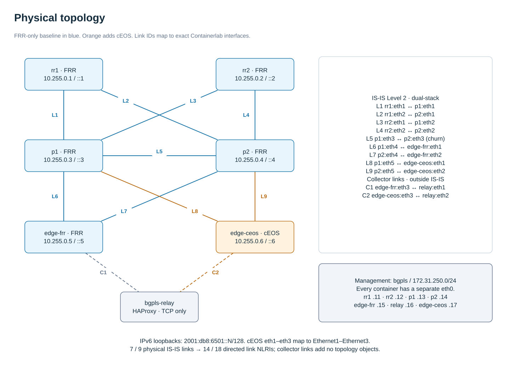

# Your first BGP-LS link withdrawal

Watch what happens to the topology when one backbone link goes down. Five FRRouting routers run IS-IS in Containerlab. On your Mac, `bgpls` opens one BGP-LS session to the edge router and shows what it advertises. You can do the whole exercise in two Terminal tabs.



Use the blue FRR topology for this exercise. The optional orange cEOS extension is available in the source checkout.

## Before you start

Use an Apple Silicon Mac running macOS 15 or newer. Open two macOS Terminal tabs, **Collector** and **Control**. You can leave Xcode and VS Code closed.

In **Collector**, use [Homebrew](https://brew.sh/) to install the prebuilt CLI and check its version.

```sh
brew install RouteObjects/tap/bgpls && bgpls --version
```

For this release, the collector prints `0.1.0`. Homebrew also installs Python, the lab scripts, and the five FRR router configurations. In **Control**, point the walkthrough at the installed scripts. The packaged guide is alongside them at `$(brew --prefix bgpls)/share/bgpls/FRR-LAB.md`.

```sh
LAB_TOOLS="$(brew --prefix bgpls)/share/bgpls/lab-examples/bgpls"
```

If you use the release archive or build from source instead, use the matching paths in each tab.

| Installation | Collector tab | Control tab |
| --- | --- | --- |
| Unpacked [Apple Silicon release archive](https://github.com/RouteObjects/bgpls/releases/download/0.1.0/bgpls-0.1.0-darwin-aarch64.tar.gz) | From the unpacked directory, run `export PATH="$PWD/bin:$PATH"`. Keep the adjacent `libexec` directory in place. | From the same unpacked directory, set `LAB_TOOLS="$PWD/lab-examples/bgpls"`. |
| [Source build](../GettingStarted.md) | From the project root, run `export PATH="$PWD/.build/release:$PATH"`. | From the project root, set `LAB_TOOLS="$PWD/lab-examples/bgpls"`. |

For an archive or source installation, check the Mac's Python version in **Control**. If the command is missing or reports an older version, install Python 3.9 or newer before continuing.

```sh
python3 --version
```

The demo routers run in an OrbStack guest with Docker Engine, stable Containerlab 0.83.0 or newer, and access to the same absolute deployment path as the Mac. The [one-time OrbStack setup](../OrbStackSetup.md) covers guest preparation. Its Swift and source-tree checks apply to the developer walkthrough.

**If someone prepared the demo for you**, ask for the guest name, deployment directory, and collector port. Each FRR producer accepts one collector at a time.

In **Control**, select the guest and deployment directory supplied for your demo. The developer walkthrough uses these values.

```sh
export CLAB_MACHINE=clab
LAB_DIR="$HOME/clabs/bgpls-demo"
```

If the routers are **already running**, use their original `LAB_DIR` and go straight to step 1. To start your own routers on a **prepared guest with no bgpls deployment**, run this in **Control**. The default workflow requires a free Mac localhost port `11790`. If another guest already owns that port, use the [isolated-guest recipe](#running-alongside-an-existing-lab) instead. Keep **Control** open for the link exercise and cleanup.

```sh
LAB_DIR=$(mktemp -d "$HOME/bgpls-demo.XXXXXX") && "$LAB_TOOLS/deploy.sh" "$LAB_DIR"
```

Continue when you see `FRR relay: 127.0.0.1:11790`.

## 1. Connect from the Collector tab

In the Mac **Collector** tab, set `COLLECTOR_PORT` to the Mac port for your deployment. If someone prepared the lab, use the port they gave you. For the default deployment, enter `COLLECTOR_PORT=11790`. For the SSH forward shown below, enter `COLLECTOR_PORT=22790`. The `CLAB_MACHINE` setting in **Control** selects the guest for router commands. The collector connects to the localhost port you select here.

Run the collector in that same tab and leave it running during the link exercise.

```sh
bgpls run \
  --peer 127.0.0.1 --port "$COLLECTOR_PORT" \
  --local-as 65001 --peer-as 65001 \
  --bgp-identifier 192.0.2.101 --local-address 127.0.0.1 \
  --hold-time 9 --watch --show-attributes --dump-rib
```

The localhost listener forwards the session to `edge-frr`. After `state Established`, use the watch output to identify the routers, circuits, and loopbacks.

| Watch output | What you can identify |
| --- | --- |
| `WATCH upsert node` | Find the router named `p2`. |
| `WATCH upsert link` | Find both directions of `10.254.0.8` (p1) ↔ `10.254.0.9` (p2). Each router advertises its end of the circuit. |
| `WATCH upsert prefix` | Find p2’s IPv4 loopback `10.255.0.4/32` and IPv6 loopback `2001:db8:6501::4/128`. Both arrive over this IPv4 session. |

## 2. Take one circuit down and restore it

Once you have seen both directions of the p1–p2 link, take it down from the same **Control** tab on the Mac.

```sh
"$LAB_TOOLS/churn-link.sh" "$LAB_DIR" down
```

In **Collector**, look for two `WATCH withdraw link` lines with those same addresses, one in each direction. The BGP session stays up. As soon as you see both withdrawals, **restore the circuit** in **Control**. If you miss either line, restore it after at most 90 seconds anyway. An explicit `down` leaves the circuit down until you run `up`.

```sh
"$LAB_TOOLS/churn-link.sh" "$LAB_DIR" up
```

Keep the same collector running. Watch for two `WATCH upsert link` lines that match the original directions and their IPv4 **and** IPv6 endpoints. If you saw only one withdrawal or one returning direction, the exercise is incomplete even if the final counts look right.

## 3. Read the result and finish

After both links return and updates settle, press **Ctrl-C** in **Collector**. Look for `SIGINT — session stopped` and `RIB final` with `nodes=5 links=14 prefixes=10`. Seven physical circuits account for the fourteen directed links. If extra links persist, see the [known FRR limitation](../../../lab-examples/bgpls/README.md#known-frr-limitation).

For an automated comparison of every topology identity, first stop the manual collector. The verifier always connects to `127.0.0.1:11790`. Run it in **Control** only if your disposable deployment owns that Mac listener. If you used a different port, use the watch output and final RIB checks above. The verifier starts its own session and exercises the link and IPv6 prefixes.

In **Control**, select the collector for your installation before starting the verifier.

| Installation | Command |
| --- | --- |
| Homebrew | Run `BGPLS_BINARY="$(brew --prefix bgpls)/bin/bgpls"`. |
| Unpacked release archive | From the unpacked directory, run `BGPLS_BINARY="$PWD/bin/bgpls"`. |
| Source build | From the project root, run `BGPLS_BINARY="$PWD/.build/release/bgpls"`. |

```sh
"$LAB_TOOLS/verify.sh" "$LAB_DIR" "$BGPLS_BINARY" --churn
```

Ctrl-C ends your collector session. The routers keep running for the next operator. If this was your own disposable deployment, you can remove its containers and network from **Control**.

```sh
"$LAB_TOOLS/destroy.sh" "$LAB_DIR"
```

For a visual map of the two Terminal tabs, open the [collector and control diagram](../Lab%20Topology.svg). For the optional live VS Code topology view, follow [the editor setup](../GettingStarted.md#4-optional-open-the-topology-in-vs-code).

The [packaged quickstart rehearsal](../../../lab-examples/bgpls/VALIDATION.md#2026-11-20-packaged-frr-quickstart) recorded the complete sequence on one session: 14 directed links at baseline, 12 after both withdrawals, and the original 14 after restoration.

## Running alongside an existing lab

If Mac port `11790` is already occupied, the macOS deployment script refuses to proceed. Forwarding a different collector port only helps **after** deployment. Use a separate network-isolated OrbStack guest with its own Docker daemon, Containerlab, and a shared directory mounted at the same absolute path on the Mac and in that guest.

In **Control**, substitute the **new guest name** and its **existing shared directory** below. Use the `LAB_TOOLS` you set in [Before you start](#before-you-start). Copying just these files into a fresh directory also works when Homebrew's installation prefix is outside the guest's file share.

```sh
export CLAB_MACHINE=clab-demo
SHARED_DIR="$HOME/bgpls-shared"
RUN_DIR=$(mktemp -d "$SHARED_DIR/quickstart.XXXXXX") && (
  set -e
  mkdir -p "$RUN_DIR/package/lab-examples"
  cp -R "$LAB_TOOLS" "$RUN_DIR/package/lab-examples/bgpls"
  orb -m "$CLAB_MACHINE" -u root "$RUN_DIR/package/lab-examples/bgpls/deploy.sh" "$RUN_DIR/deployment"
)
```

After deployment succeeds, keep these values in **Control** for the `down`, `up`, and `destroy.sh` commands above:

```sh
LAB_TOOLS="$RUN_DIR/package/lab-examples/bgpls"
LAB_DIR="$RUN_DIR/deployment"
```

In an additional **Mac Terminal** tab, select that same guest and a free Mac port. Leave the tunnel open while collecting:

```sh
ssh -N -o ExitOnForwardFailure=yes -L 127.0.0.1:22790:127.0.0.1:11790 clab-demo@orb
```

Return to step 1 and set `COLLECTOR_PORT=22790` in **Collector** for the forward shown above. If you chose another local port, use that value. The collector reaches the new guest's relay and the earlier lab keeps its listener. Once the collector has exited, press Ctrl-C in the tunnel tab.
