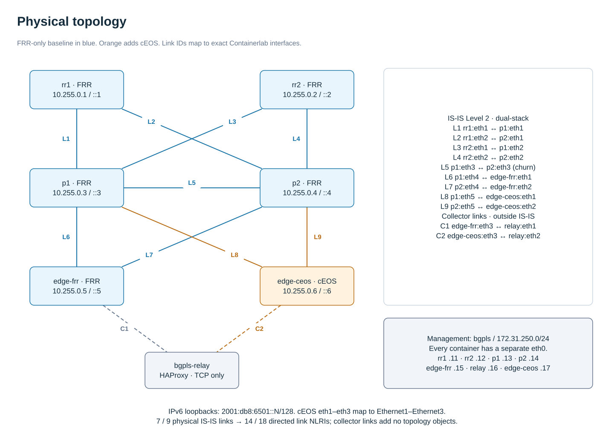
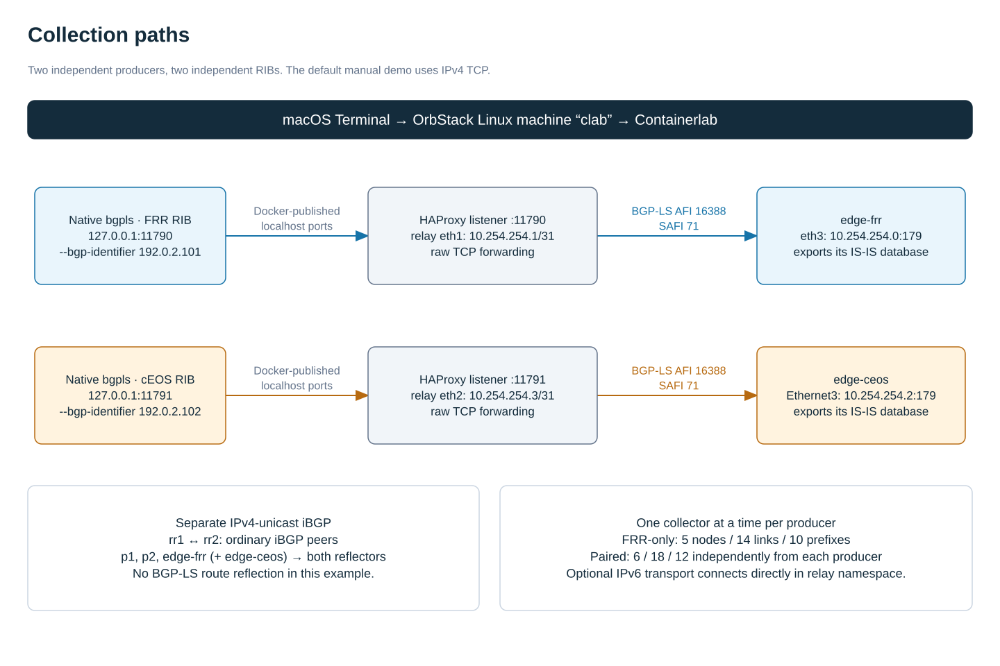
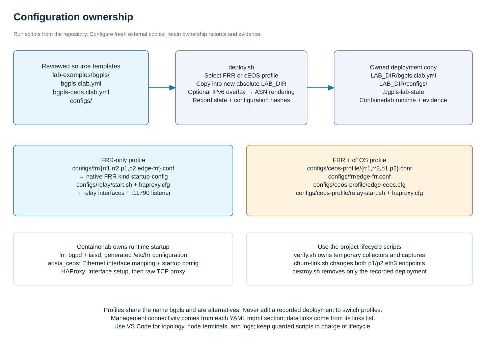

# Reference-lab guide

To observe a link withdrawal on a prepared lab, start with the
[network operator walkthrough](Operators/GettingStarted.md).
To build the collector and set up your own host, follow the
[developer walkthrough](GettingStarted.md).
For a prepared host, use the [terminal-first quickstart](../../lab-examples/bgpls/README.md).
The native Swift collector runs on macOS; an OrbStack Linux machine hosts the
Containerlab routers. Native Linux is also supported. VS Code is optional.

- [One-time OrbStack setup](OrbStackSetup.md): create and prepare the Linux host from macOS Terminal.
- [Prerequisites](Prerequisites.md): required versions, images, and optional editor access.
- [Script examples](ScriptExamples.md): deployment ownership, link flaps, verification, IPv6 transport, and four-byte ASNs.
- [cEOS extension](../../lab-examples/bgpls/CEOS.md): bring your own entitled image and compare two independent producers.
- [Typed attributes](../../lab-examples/bgpls/ATTRIBUTES.md): inspect names, metrics, and bandwidth; run controlled probes.
- [Fixture provenance](FixtureProvenance.md): retained capture boundaries and byte-preservation checks.
- [Qualification summary](../../lab-examples/bgpls/VALIDATION.md) with tested configurations and results.

## Diagrams

Open [Topology.drawio](Topology.drawio) in draw.io to edit its three named pages.
The SVGs below are static exports of those pages. The diagrams describe the
FRR + cEOS superset; orange elements belong only to the optional cEOS profile.

### Physical topology

### Collection paths

### Configuration ownership

IS-IS connectivity, IPv4-unicast route reflection, and BGP-LS collection serve
different purposes. Both topology address families are advertised over the
default IPv4 collector sessions. The opt-in IPv6 transport workflow instead
runs Linux collectors in the relay network namespace and connects directly to
the exporters; it does not add IPv6 localhost HAProxy listeners.
