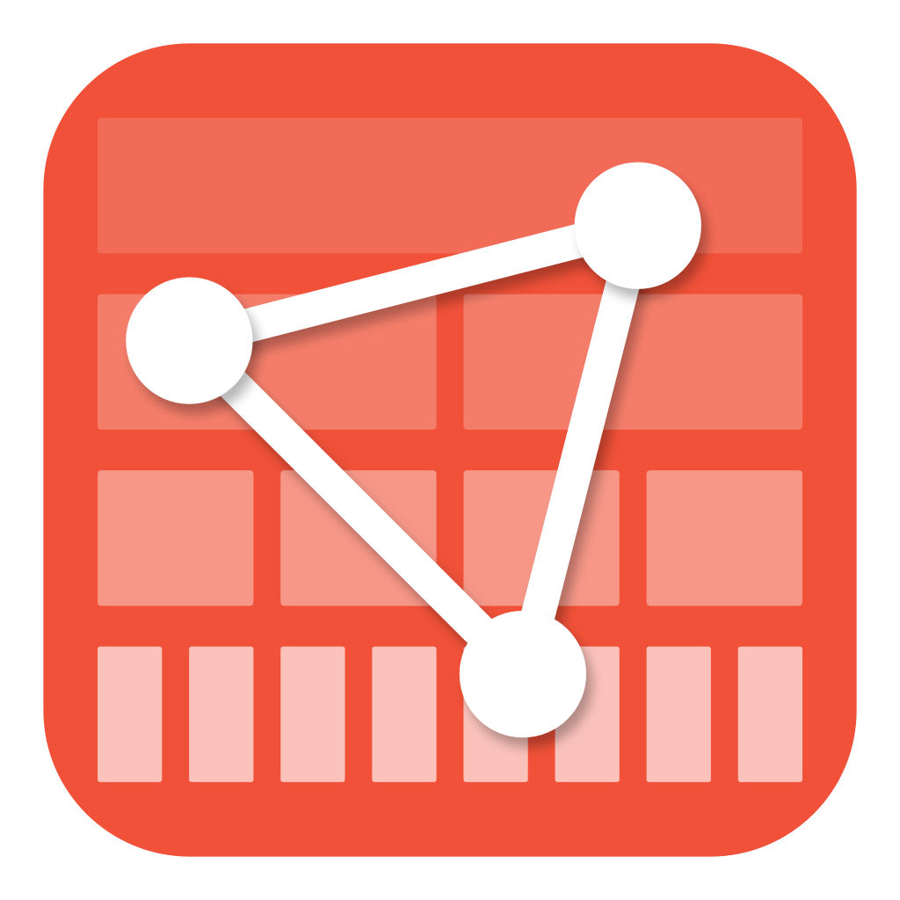

<h1 align="left">
  
  &nbsp;bgpls
</h1>

[](https://swiftpackageindex.com/RouteObjects/bgpls)
[](https://swiftpackageindex.com/RouteObjects/bgpls)

`bgpls` is an open-source BGP-LS client and collector written in Swift.
It connects to a BGP Link-State producer and tracks the nodes, directed links,
and IPv4 and IPv6 prefixes it advertises. Watch a backbone link disappear and
return in the CLI, or consume the same updates in your Swift application with
`BGPLSClient`.
The current specification is [RFC 9552](https://www.rfc-editor.org/rfc/rfc9552.html),
which supersedes [RFC 7752](https://www.rfc-editor.org/rfc/rfc7752.html).

`bgpls` is part of [RouteObjects’ **Swift for Infrastructure** initiative](https://routeobjects.com/),
demonstrating practical network-control software built in Swift. It is powered by
[swift-cidr](https://github.com/RouteObjects/swift-cidr) for typed IP addresses,
canonical network prefixes, endpoints, and autonomous system numbers.

## Install with Homebrew

On an Apple Silicon Mac running macOS 15 or newer, install the prebuilt CLI
with [Homebrew](https://brew.sh/) and check its version.

```sh
brew install RouteObjects/tap/bgpls && bgpls --version
```

Run `bgpls run --help` for options to connect to your own BGP-LS producer.
To try the five-router FRR lab included with the formula, follow the
[operator walkthrough](Documentation/Lab/Operators/GettingStarted.md).

## Watch the FRRouting lab in three commands

To run the demo from source, use macOS Terminal at the repository root on an
Apple Silicon Mac with Swift 6.3+ and a prepared OrbStack `clab` guest.
The [one-time setup](Documentation/Lab/OrbStackSetup.md#6-verify-shared-absolute-paths)
prepares `$HOME/clabs` as a shared parent directory. Start with a fresh
`$HOME/clabs/bgpls-demo` path and a free localhost port `11790`.
For first-time setup, follow the [Mac walkthrough](Documentation/Lab/GettingStarted.md).

```sh
swift build -c release --product bgpls &&
./lab-examples/bgpls/deploy.sh "$HOME/clabs/bgpls-demo" &&
.build/release/bgpls run \
  --peer 127.0.0.1 --port 11790 \
  --local-as 65001 --peer-as 65001 \
  --bgp-identifier 192.0.2.101 \
  --watch --show-attributes --dump-rib
```

Look for `state Established` followed by `WATCH` updates. The default FRR
topology converges to **5 nodes, 14 directed links, and 10 prefixes**.
To watch both directions of the p1–p2 link disappear and return, follow the
[link exercise](Documentation/Lab/GettingStarted.md#6-watch-one-link-disappear-and-return)
with `LAB_DIR="$HOME/clabs/bgpls-demo"` in the second Terminal. When finished, press
Ctrl-C in the collector Terminal to print the final topology, then remove your
deployment.

```sh
./lab-examples/bgpls/destroy.sh "$HOME/clabs/bgpls-demo"
```

The optional [FRR + cEOS profile](lab-examples/bgpls/CEOS.md) supplies
**6 nodes, 18 directed links, and 12 prefixes per producer**, with separate
collectors on ports `11790` and `11791`. The cEOS image requires the user's own
vendor entitlement. The two profiles are alternative deployments, both named
`bgpls`; each producer accepts one collector at a time.

For the CLI alone, build the release executable on macOS 15+ or Linux and run
`.build/release/bgpls --help`. Run the offline tests with `./scripts/test.sh`.

## CLI output and shutdown

`--watch` prints RIB snapshots, upserts, and withdrawals as they arrive.
`--show-attributes` adds typed attribute fields to upserts and requested dumps.
`--dump-rib` prints the full RIB on termination; without it, termination prints
the status and one counts line. Neither `--watch` nor `--show-attributes` enables
a final dump implicitly.

Node output uses `AS not-advertised` when the Node Descriptor's ASN sub-TLV
(512) is absent. It does not infer a topology ASN from the BGP session's ASN.
Other unknown descriptor fields retain their own placeholders.

Ctrl-C or SIGTERM requests orderly cleanup. Admitted observations finish before
the optional watch task, PCAP output, and final report complete.

| Termination | Process status |
| --- | ---: |
| Normal established peer closure | `0` |
| Connection or session failure | `1` |
| SIGINT after cleanup | `130` |
| SIGTERM after cleanup | `143` |

Capture is opt-in: `--pcap FILE` records session traffic at an explicit path,
while `--pcap-auto` selects a filename in the current working directory.
Omitting both disables capture; combining them is a validation error.

Automatic filenames use
`bgpls_yyyyMMdd_HHmmssZ_peer-ADDRESS_port-PORT_UUID.pcap`.
The timestamp is selected before connecting, using UTC, the Gregorian calendar,
and a fixed POSIX locale; `Z` is literal. `ADDRESS` is the configured numeric
peer address without a prefix, with IPv6 colons replaced by hyphens. `UUID` is
a full lowercase, hyphenated UUID. The peer can be a relay, so its address and
port do not identify the vendor or topology producer. The CLI prints the selected
absolute path with control characters escaped before creating the session;
the existing `writing PCAP` message separately confirms capture setup.

Both options require a **new file in a trusted directory**. Existing paths are
refused, including symbolic links; automatic naming does not probe for available
names, overwrite, or retry a collision. New files request owner-only permissions
(`0600`, subject to a more restrictive umask). Ordinary parent-directory
symlinks, such as macOS `/tmp`, are supported; this does not isolate the path
from an untrusted directory owner. Creation or header-write failures stop setup
before connecting. Later capture-write errors are logged while collection
continues, so a successful session does not by itself certify a complete capture.

Each capture admits at most **8 MiB of pending encoded PCAP bytes** and
**4,096 pending chunks**, including the write in progress. If either limit
would be exceeded, capture stops for the rest of that session, accepted chunks
drain, and the file closes. A warning identifies the incomplete capture;
**BGP collection, RIB updates, and watch events continue** with unchanged exit
statuses. The warning runs on the file queue and may wait behind stalled I/O.
These internal limits bound pending capture data and chunk count, not total
process memory, disk usage, or shutdown duration. See the
[capture budget](Documentation/Architecture.md#pcap-capture-budget) for details.

`--log-updates` enables capped raw UPDATE hexadecimal logging. Protocol
diagnostics are also emitted when that logging is disabled. Capture files and
logs may contain sensitive topology information.

`bgpls show` and `bgpls stop` print usage guidance; there is no daemon control
socket or cross-process RIB query interface. Use the foreground `run` command
and its signal handling.

## Library and protocol scope

The library is independent of CLI signal handling. Applications construct an
explicit `BGPSessionConfiguration`, run a session, consume `ribChanges`, and
read a typed RIB or a JSON snapshot. See the
[compilable library example](Documentation/LibraryUsage.md).

- IPv4 and unscoped IPv6 session transport, with an independent nonzero BGP identifier.
- Two-byte and four-byte ASN session negotiation, including capability 65.
- IS-IS and OSPF node identities, links, and canonical IPv4/IPv6 reachability networks.
- Advertisements, withdrawals, deterministic snapshots, and typed watch records.
- Node names, link IGP metrics, prefix metrics, and advertised link bandwidth.
- Unknown data and original attribute evidence retained alongside typed projections.
- Native NIO read backpressure, bounded pending UPDATE admission, and ordered cleanup.

See [protocol support](Documentation/ProtocolSupport.md) for exact parsing,
timer, recovery, and interoperability boundaries. The package uses
`swift-cidr` 0.11.0 for typed addresses, networks, endpoints, and ASNs.

## Operational limits

The library is a collector and reference implementation. Production deployment
needs an application-owned policy for reconnection, persistence, reconciliation,
monitoring, authentication, and resource limits.

- Callbacks run synchronously on the session actor and must return promptly.
  Blocking callbacks or slow stderr destinations can delay processing and
  cleanup. Cancellation cannot interrupt arbitrary synchronous callback code.
- Native watermarks reduce read demand; a separate limit permits at most 1,024
  pending UPDATE observations. Exceeding it terminates the session and reports
  a collection gap. This does not bound the RIB or total process memory.
- Each `ribChanges` subscription retains the newest 512 events by default.
  Slow subscribers can lose events; exact replay requires the complete event
  sequence. There is no overflow notification or automatic resynchronization.
- Rejected withdrawals or replacements can leave earlier accepted information
  stale. Disconnect retains the last RIB without proving it is still current.
- Hold timers continue during read suspension. An unread KEEPALIVE cannot
  refresh a deadline; negotiated hold zero can allow an indefinite pause.
- Outbound NOTIFICATION support is deliberately limited. AS paths remain raw
  evidence; there is no general path reconstruction or route selection.

The [architecture guide](Documentation/Architecture.md) explains ownership,
buffering, failure ordering, and cleanup. Historical lab qualification is
summarized separately from current checks in the
[public validation record](lab-examples/bgpls/VALIDATION.md). Native AMD64
package tests do not establish AMD64 vendor-lab qualification.

## Documentation and contributions

- [Documentation index](Documentation/README.md)
- [0.1.0 release notes](Documentation/ReleaseNotes/0.1.0.md)
- [Contributing and offline checks](CONTRIBUTING.md)
- [Report a vulnerability privately](SECURITY.md#report-a-vulnerability-privately)

Licensed under [Apache License 2.0](LICENSE). Vendor images are not included.
