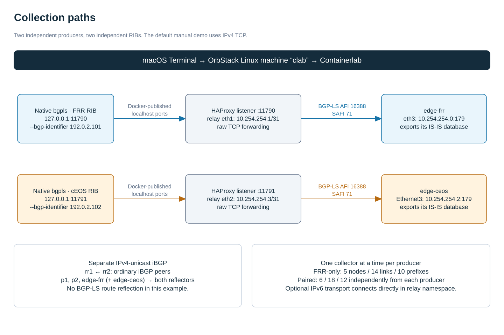

# Add an independent cEOS producer

The optional ARM64 profile adds Arista cEOS to the FRR topology and gives it a
separate BGP-LS collector connection. Both producers describe the same converged
IS-IS topology: **6 nodes / 18 directed links / 12 prefixes per collector**.
This tests independent implementations; it does not combine their RIBs.

Complete the [prerequisites](../../Documentation/Lab/Prerequisites.md) first.
The FRR-only and cEOS profiles share the deployment name `bgpls`, so stop manual
collectors and destroy any existing owned deployment before selecting this one.

## Bring your own image

Obtain `cEOSarm-lab-4.36.2F.tar.xz`, its matching `.sha512sum`, and `.json`
metadata through your own Arista account and entitlement. Keep them outside the
repository. The example supplies configuration, not a vendor image or license.

On macOS, point to the downloaded archive and verify it:

```sh
CEOS_ARCHIVE="$HOME/Downloads/cEOSarm-lab-4.36.2F.tar.xz"
(
  cd "$(dirname "$CEOS_ARCHIVE")"
  shasum -a 512 -c "$(basename "$CEOS_ARCHIVE").sha512sum"
  shasum -a 256 "$(basename "$CEOS_ARCHIVE")"
)
```

Compare SHA-256 with the vendor JSON metadata. The previously qualified archive
had SHA-256 `096ba4e1c43f797e3ac39a7a78b064e70e430b7c73425b12a42d384ae0281841`.
Checksum agreement verifies integrity against the downloaded metadata; it is
not a claim that an optional CMS signature was authenticated.

Import into Docker **inside the OrbStack `clab` machine**:

```sh
orb -m clab -u root docker import --platform linux/arm64 \
  "$CEOS_ARCHIVE" ceosarm:4.36.2F
orb -m clab -u root docker image inspect ceosarm:4.36.2F \
  --format '{{.Os}}/{{.Architecture}}'
```

Expect `linux/arm64`. Native ARM64 Linux uses the same Docker commands without
the `orb` prefix. The import flag labels the architecture; it does not convert
an Intel image. The deploy script checks native ARM64 and requires this local
image; the topology never pulls it. The qualified image reported
`4.36.2F-49692632.4362F.1 (engineering build)`, architecture `aarch64`.
Do not upload vendor archives, images, or credentials with this example.

## Deploy and connect

From the repository root, after safely removing the previous owned deployment:

```sh
swift build -c release --product bgpls
LAB_DIR="$HOME/clabs/bgpls-ceos-demo"
mkdir -p "$(dirname "$LAB_DIR")"
./lab-examples/bgpls/deploy.sh --ceos "$LAB_DIR"
```

In one macOS Terminal, collect from **FRR**:

```sh
.build/release/bgpls run \
  --peer 127.0.0.1 --port 11790 \
  --local-as 65001 --peer-as 65001 \
  --bgp-identifier 192.0.2.101 --local-address 127.0.0.1 \
  --hold-time 9 --watch --show-attributes --dump-rib
```

In a second macOS Terminal in the same repository, collect from **cEOS**:

```sh
.build/release/bgpls run \
  --peer 127.0.0.1 --port 11791 \
  --local-as 65001 --peer-as 65001 \
  --bgp-identifier 192.0.2.102 --local-address 127.0.0.1 \
  --hold-time 9 --watch --show-attributes --dump-rib
```

Wait for convergence. Each RIB should contain `6/18/12`. Stop either collector
with Ctrl-C; the other session should continue. Each producer supports only
one collector at a time, so stop both before automated verification.



## Added links and configuration

| Endpoints | IPv4 addresses | IPv6 IS-IS slot |
| --- | --- | --- |
| `p1:eth5` ↔ `edge-ceos:eth1` / `Ethernet1` | `10.254.0.14/31` ↔ `.15/31` | `2001:db8:6501:8::/127` |
| `p2:eth5` ↔ `edge-ceos:eth2` / `Ethernet2` | `10.254.0.16/31` ↔ `.17/31` | `2001:db8:6501:9::/127` |
| `edge-ceos:eth3` / `Ethernet3` ↔ `bgpls-relay:eth2` | `10.254.254.2/31` ↔ `.3/31` | Not IS-IS |

Each IS-IS slot assigns `::` to the first endpoint and `::1` to the second.
cEOS has loopbacks `10.255.0.6/32` and `2001:db8:6501::6/128`, System ID
`0000.0000.0006`, and management `172.31.250.17`. Its links use MTU 1500 to
match the FRR/cEOS adjacency requirements. The configuration sets an IPv6 TE
router ID for IPv6 link-descriptor export; that is separate from the IPv4 BGP
identifier used for session negotiation.

[`bgpls-ceos.clab.yml`](bgpls-ceos.clab.yml) selects
[`configs/ceos-profile/`](configs/ceos-profile/) for the four core routers,
cEOS, and the paired relay. `edge-frr` retains its
[`configs/frr/edge-frr.conf`](configs/frr/edge-frr.conf). The relay uses source
`10.254.254.1` for FRR and `10.254.254.3` for cEOS. It forwards raw BGP bytes,
without TLS, HTTP checks, or PROXY-protocol headers.

Use [script recipes](../../Documentation/Lab/ScriptExamples.md) for link churn,
verification, high ASNs, or IPv6 session transport. After stopping collectors:

```sh
./lab-examples/bgpls/destroy.sh "$LAB_DIR"
```

This retains evidence and does not remove the imported vendor image. See
[qualification boundaries](VALIDATION.md) before treating another image or
platform as supported.
