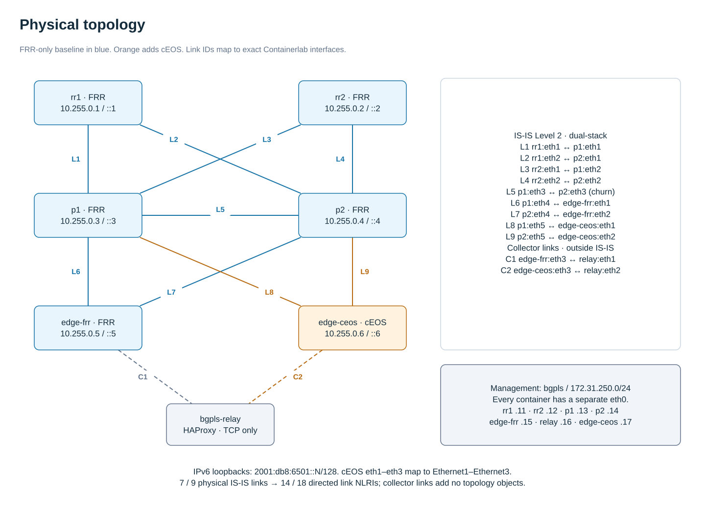

# BGP-LS reference lab

## TL;DR — See it work

First time on macOS? The [hands-on walkthrough](../../Documentation/Lab/GettingStarted.md)
covers downloading the source, preparing OrbStack, opening the topology in VS Code,
and watching both directions of a link disappear and return. If you have the
packaged collector and lab scripts, use the [operator walkthrough](../../Documentation/Lab/Operators/GettingStarted.md).
If you only need to
prepare the Linux host, follow the [one-time OrbStack setup](../../Documentation/Lab/OrbStackSetup.md).

New deployments require stable **Containerlab 0.83.0 or newer**. The setup guide
installs 0.83.0, which includes the FRR `vtysh` startup fix. Existing deployments
retain their recorded ownership and can still be inspected or destroyed with
their original runtime.

Run these commands from the repository root in **macOS Terminal**, after installing
[the prerequisites](../../Documentation/Lab/Prerequisites.md). Swift and `bgpls`
run on macOS; Docker, Containerlab, and the routers run inside OrbStack's `clab`
Linux machine. This default profile needs no proprietary router image.

Build the collector and select a **new absolute directory outside the repository**.
The parent directory must be accessible inside the Linux machine.

```sh
swift build --product bgpls
LAB_DIR="$HOME/clabs/bgpls-demo"
mkdir -p "$(dirname "$LAB_DIR")"
./lab-examples/bgpls/deploy.sh "$LAB_DIR"
```

Start a collector in the same Terminal:

```sh
.build/debug/bgpls run \
  --peer 127.0.0.1 --port 11790 \
  --local-as 65001 --peer-as 65001 \
  --bgp-identifier 192.0.2.101 --local-address 127.0.0.1 \
  --hold-time 9 --watch --show-attributes --dump-rib
```

Look for `state Established`, followed by node, link, and prefix watch events.
The converged topology has **5 nodes / 14 directed links / 10 prefixes**. Each
router contributes an IPv4 and an IPv6 loopback, even though this collector's
TCP session uses IPv4. An initial empty watch snapshot is expected.

If FRR reports extra links after churn, see the
[known FRR limitation](#known-frr-limitation). The expected counts and
verification checks remain unchanged.

Wait for both directions of the p1–p2 link between `10.254.0.8` and `10.254.0.9`.
In a second Terminal, enter the repository directory, set the same guest and
`LAB_DIR` used for deployment, and take the circuit down:

```sh
LAB_DIR="$HOME/clabs/bgpls-demo"
./lab-examples/bgpls/churn-link.sh "$LAB_DIR" down
```

Look for two `WATCH withdraw link` lines, one for p1 → p2 and one for p2 → p1.
As soon as you see both, restore the circuit in the second Terminal. An
explicit `down` persists. If either withdrawal is missing after 90 seconds,
restore the circuit anyway and record which event you missed.

```sh
./lab-examples/bgpls/churn-link.sh "$LAB_DIR" up
```

Wait for both `WATCH upsert link` lines with the original IPv4 and IPv6
endpoints on the same collector session. A timed flap can finish before FRR
advertises the change. Press **Ctrl-C** in the collector Terminal to stop
cleanly and print the complete final RIB. Its exit status is `130`. Without
`--dump-rib`, shutdown prints only a counts summary. `--show-attributes` enriches
watch events and an explicitly requested dump; it does not itself enable a dump.

For repeatable verification with bounded waits for withdrawals and exact
restoration, stop manual collectors first, then run:

```sh
./lab-examples/bgpls/verify.sh "$LAB_DIR" "$PWD/.build/debug/bgpls" --churn
```

The verifier starts its own collector and also tests independent IPv6 prefix
changes. A passing run requires observed changes and restoration of the full
NLRI identities, not just the final counts.

When finished, stop all collectors and destroy **this owned deployment**:

```sh
./lab-examples/bgpls/destroy.sh "$LAB_DIR"
```

The state directory and evidence remain available for inspection. A later
deployment needs a fresh directory. Do not replace this command with a global
Containerlab destroy command.

## What is running

This lab demonstrates `bgpls`, part of
[RouteObjects’ **Swift for Infrastructure** initiative](https://routeobjects.com/)
and powered by [**swift-cidr**](https://github.com/RouteObjects/swift-cidr) network types.



Five FRR routers form one dual-stack IS-IS Level 2 topology. `rr1` and `rr2`
reflect **IPv4 unicast** routes. `edge-frr` separately exports its IS-IS database
as BGP-LS. The HAProxy relay is a **raw TCP proxy**, not a BGP speaker or route
reflector. It exposes the producer to the native collector through localhost.
BGP-LS sessions do not pass through the route reflectors in this example.

| Profile | Deployment option | Producer listeners | Expected RIB per producer |
| --- | --- | --- | --- |
| FRR only | default | `127.0.0.1:11790` | `5 nodes / 14 links / 10 prefixes` |
| FRR + cEOS | `--ceos` | FRR `:11790`, cEOS `:11791` | `6 nodes / 18 links / 12 prefixes` |

The profiles are **alternatives** with the same deployment name, `bgpls`.
Destroy the existing owned deployment before switching profiles. Each producer
permits **one collector at a time**. Two independent collectors can run together
in the cEOS profile, one per producer; they maintain separate RIBs.

See [the cEOS extension](CEOS.md) for entitled ARM64 image preparation and both
collector commands. The [editable three-page diagram](../../Documentation/Lab/Topology.drawio)
also explains collection paths and configuration ownership.

## Topology and configuration

The YAML files are authoritative:
[`bgpls.clab.yml`](bgpls.clab.yml) and [`bgpls-ceos.clab.yml`](bgpls-ceos.clab.yml).
The default has seven IS-IS links plus one collector link. The cEOS profile adds
two IS-IS links and its own collector link. Link NLRIs are directional, so seven
physical IS-IS links produce fourteen link objects.

IS-IS advertises only passive loopbacks as prefixes. Numbered transit addresses
remain link descriptors; their connected `/31` and `/127` networks are not
additional Prefix NLRIs. IPv4 unicast BGP advertises discard-only test routes
`192.0.2.1/32` through `192.0.2.6/32`, not services or ping targets.

| Purpose | Address space |
| --- | --- |
| Docker management | `172.31.250.0/24` (`bgpls` network) |
| Router loopbacks | `10.255.0.1/32`–`10.255.0.6/32`; `2001:db8:6501::1/128`–`::6/128` |
| IS-IS links | `10.254.0.0/31` through `10.254.0.16/31`; IPv6 slots `2001:db8:6501:1::/127` through `:9::/127` |
| FRR collector link | producer `10.254.254.0/31`, relay `10.254.254.1/31` |
| cEOS collector link | producer `10.254.254.2/31`, relay `10.254.254.3/31` |

Choose an isolated host where these networks do not overlap existing routes.
The optional sixth router, last two IS-IS slots, and second collector link exist
only in the cEOS profile. The IPv6 documentation prefix is for the isolated lab.

| Configuration | Controls |
| --- | --- |
| [`configs/frr/`](configs/frr/) | All default FRR routers; `edge-frr` in both profiles |
| [`configs/ceos-profile/`](configs/ceos-profile/) | cEOS-profile core routers, `edge-ceos`, and paired relay |
| [`configs/relay/`](configs/relay/) | Default relay interface setup and TCP listener |
| Copied topology and state record in `LAB_DIR` | Deployment ownership and configuration integrity |

`deploy.sh` copies the selected configuration into fresh external state before
rendering optional changes. Do not edit recorded deployment copies: ownership
and hash checks deliberately reject drift.

## Known FRR limitation

The pinned FRR lab image has shown stale BGP-LS Link NLRIs after a link's IPv6
address descriptors change during churn. FRR can advertise the replacement
identity without withdrawing the previous one, leaving extra link records in
its own BGP-LS RIB and in collectors even after the IGP topology has converged.
These records do not represent additional physical links. The same behavior
was reproduced independently with GoBGP and bgpls;
[FRR PR #24113](https://github.com/FRRouting/frr/pull/24113) contains the proposed
fix, regression tests, and sanitized wire evidence; it remains open as of
2026-11-09.

Address descriptors participate in Link NLRI identity. bgpls preserves those
distinct advertisements and applies received withdrawals, rather than merging
records by their displayed endpoints or inventing withdrawals. Restarting only
the collector is not a reliable workaround: FRR can advertise the stale entries
again. Preserve watch output or PCAP evidence and compare it with the producer's
BGP-LS table when investigating extra records.

The [2026-11-09 paired-producer regression](VALIDATION.md#2026-11-09-swift-63-paired-producer-live-regression)
passed on the existing FRR+cEOS deployment with exact restoration to `6/18/12`.
The stale-link behavior was not reproduced by that workload; this does not
establish that the producer limitation is fixed or supersede the earlier
FRR-only failures.

An upstream FRR merge or release is not itself a prerequisite for publishing
bgpls. The documented `5/14/10` and `6/18/12` expectations and exact-restoration
checks remain in force; extra retained entries still fail lab qualification.
The separate [FRR startup fix](https://github.com/srl-labs/containerlab/pull/3555)
has merged and is included in released
[Containerlab 0.83.0](https://github.com/srl-labs/containerlab/releases/tag/v0.83.0).
The [fresh 2026-11-15 FRR-only rehearsal](VALIDATION.md#2026-11-15-containerlab-0830-fresh-frr-only-rehearsal)
passed installation, startup, and the bounded `--churn` verifier on 0.83.0,
including observed withdrawals and exact restoration to `5/14/10`. The
ten-second flap produced no withdrawals on that run, and the deployment was
retained. In the [2026-11-20 packaged quickstart](VALIDATION.md#2026-11-20-packaged-frr-quickstart),
the operator waited for both p1–p2 withdrawals before restoring the link.
The final RIB matched all 29 baseline objects on the same session and scoped teardown passed.

## Next steps

- [Prerequisites and optional VS Code viewing](../../Documentation/Lab/Prerequisites.md)
- [Script recipes, link control, verification, IPv6 transport, and high ASNs](../../Documentation/Lab/ScriptExamples.md)
- [Typed-attribute inspection and controlled metric probes](ATTRIBUTES.md)
- [Qualification summary and remaining gates](VALIDATION.md)
- [Sanitized captured-fixture provenance](../../Documentation/Lab/FixtureProvenance.md)

Verification starts its own collectors. Stop manual collectors first. `--churn`
and metric probes change running router state temporarily and require exact
restoration before verification reports success.
